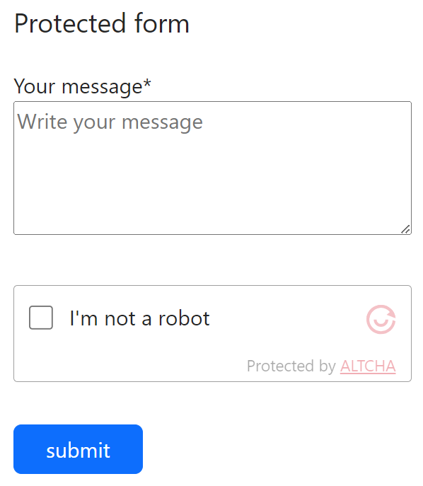
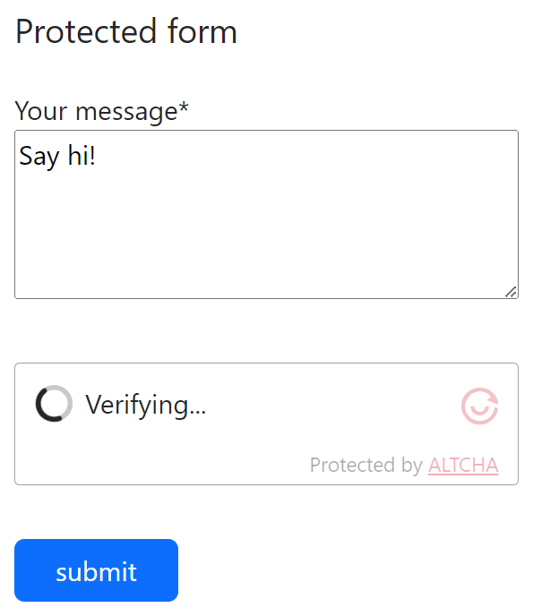
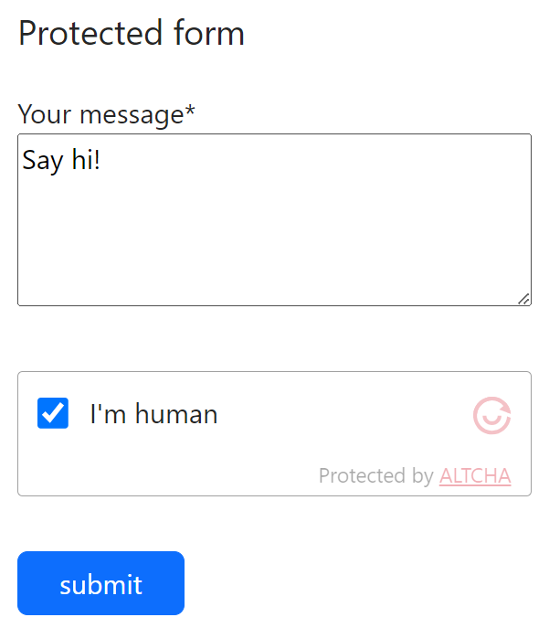

# Contao Altcha Antispam

This is a [**Contao CMS**](https://contao.org) implementation of [**Altcha**](https://altcha.org/). The extension provides a **front end** **form field** for the **Contao form generator**.

|  |  |  |
|-------------------------------------------------------------|-------------------------------------------------------------|-------------------------------------------------------------|

**ALTCHA** uses a proof-of-work (POW) mechanism to protect your forms from spam and abuse. Unlike other solutions, **ALTCHA** is **self-hosted**, does not use cookies nor fingerprinting, does not track users, and is **fully compliant** with **GDPR**.

[Visit https://altcha.org](https://altcha.org)

## Requirements

| Version | Contao       | PHP                           |
|---------|--------------|-------------------------------|
| `0.8.x` | 5.3 and 6.x  | 8.1+ (Contao 6 requires 8.4+) |
| `0.7.x` | 4.13 and 5.x | 8.1+                          |

## Installation

You can install the package via composer:

```bash
composer require markocupic/contao-altcha-antispam
```

Afterwards run the database migration task:

```bash
php vendor/bin/contao-console contao:migrate
```

## Configuration and usage
The extension runs out of the box and no further configuration is required. Nevertheless, some parameters can be configured.

The **[Complexity](https://altcha.org/docs/v2/complexity/)** can be adjusted by modifying the minimum and maximum values of the randomly generated secret number on the server side (`markocupic_contao_altcha_antispam.range_min` and `markocupic_contao_altcha_antispam.range_max`).
A lower maximum value creates a less complex challenge, requiring fewer computational iterations for the client to find a matching solution. Conversely, a higher maximum value increases the complexity, demanding more computational resources and time from the client.

Run composer install in your terminal to clear and rebuild cache if you made changes to the `config.yaml` file.

```yaml
# config/config.yaml
markocupic_contao_altcha_antispam:
  algorithm: 'SHA-256' # optional, default is SHA-256
  range_min: 290000 # Lower limit for the complexity (optional), default is 10000
  range_max: 300000 # Upper limit for the complexity (optional), default is 100000
  challenge_expiry: 3600 # optional, default is 3600
```

| key                | default value | info                                                                                                                                                                                                                                          | Required |
|--------------------|:--------------|-----------------------------------------------------------------------------------------------------------------------------------------------------------------------------------------------------------------------------------------------|:---------|
| `algorithm`        | `SHA-256`     | Choose between `SHA-256`, `SHA-512` or `SHA-384`                                                                                                                                                                                              | no       |
| `range_min`        | `10000`       | **Complexity:** Choose a higher value to increase the complexity/duration. A minimum value of the random number of at least several thousand as a "minimum required complexity" is recomended. [More](https://altcha.org/docs/v2/complexity/) | no       |
| `range_max`        | `100000`      | **Complexity:** Choose a higher value to increase the complexity/duration. The maximum value of 100,000 is a good start for most systems. [More](https://altcha.org/docs/v2/complexity/)                                                      | no       |
| `challenge_expiry` | `3600`        | Choose an expiration time, so that there is not an infinite amount of time to solve the challenge.                                                                                                                                            | no       |

## Endpoint (route)

Out of the box, the extension will use the `/_contao_altcha_challenge` endpoint to get the challenges.

Challenges are stateless: The expiry date is part of the signed salt, so the endpoint does not write to the database. Only solved
challenges are stored (in `tl_altcha_challenge`) to prevent replay attacks. Expired entries are deleted by an hourly cron job.

## Loading altcha.js

In the form field settings you can choose where the `altcha.js` script is loaded from:

- `local` (default): The script is served from the bundle (`public/altcha/dist`).
- `cdn`: The script is loaded from jsDelivr. The version is pinned (currently `altcha@2.2.4`) to match the server-side implementation.
  Please note that the IP addresses of your visitors are transmitted to jsDelivr in this case.

## Content Security Policy (CSP)

The extension supports the Content Security Policy of Contao (website root settings):

- In `local` mode (default) the [external build](https://altcha.org/docs/website-integration) of ALTCHA is used. It does not inject inline
  styles and loads its web worker from a regular file. The stylesheet is added with a `<link>` tag and the styles of the honeypot field
  carry a CSP nonce. A strict policy like `script-src 'self'; style-src 'self'; worker-src 'self'` is sufficient.
- In `cdn` mode `https://cdn.jsdelivr.net` is added to `script-src` automatically. The CDN build injects inline styles and creates its web
  worker from a `blob:` URL, so it is **not** compatible with a strict policy. Use the `local` mode if you enable the CSP.

## Upgrading from 0.7 to 0.8

- Contao 4.13 is no longer supported.
- Run `php vendor/bin/contao-console contao:migrate`. The migration converts the checkbox fields to boolean columns, deletes the unsolved
  challenges of the previous version and adds a unique index to `tl_altcha_challenge.challenge`.
- The `markocupic/contao-twig-assets` dependency has been removed. If you have customized the `form_altcha_hidden` template, replace
  `addHtmlToHead()` with Contao's `…` tag.
- The `add_content_to_head()` Twig function is deprecated; use `…` instead.
- The honeypot field names are generated differently now. Forms that were rendered before the update have to be reloaded once.
- The bundled ALTCHA script has moved from `altcha/dist/altcha.js` to `altcha/dist_external/altcha.js` (plus `altcha.css` and `worker.js`).
  If you have customized the `form_altcha_hidden` template, adjust the asset paths. `altcha.i18n.js` is no longer shipped.
